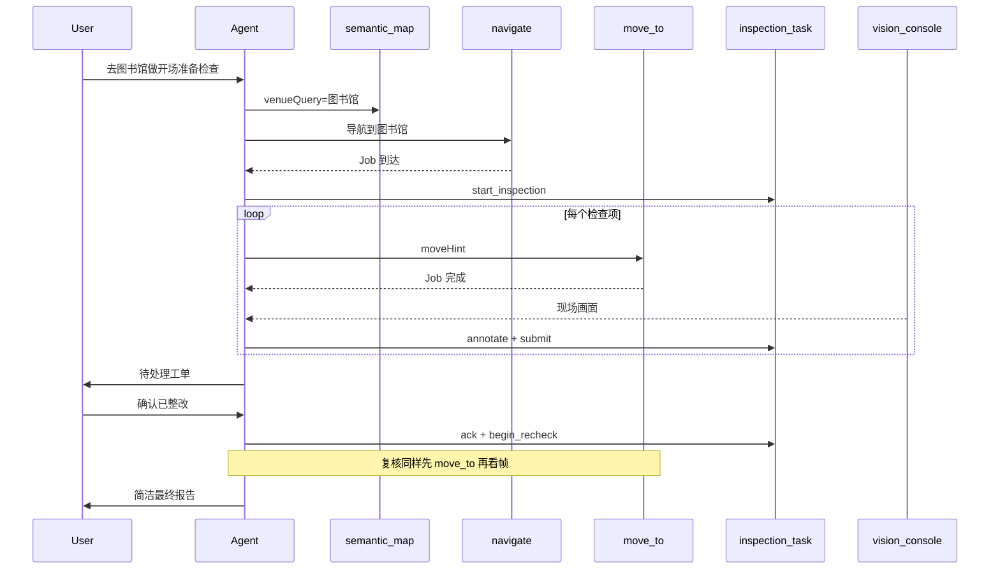

# 校园开放日 · 开场准备检查 Demo 报告

## 1. 演示定位

用机器狗 **v0.3** 演示「活动开场准备检查」完整链路：

- **先到会场**：语义地图 + `navigate`（Job mock 可）；
- **场内逐点**：语义地图没有室内点 → `move_to` 切换指示牌 / 签到台 / 通道；
- **到位后再看**：环境观察帧做结构化判定；
- **工单 → 复核 → 报告**：json-render 待处理事项 + 简洁最终报告。

| 项 | 内容 |
| --- | --- |
| 活动 | 校园开放日 |
| 会场 | 图书馆（`venueQuery`） |
| 地点描述 | 主楼一楼入口大厅 |
| 预设 | 机器狗 v0.3 |
| Skill | `event-site-inspection` |
| 配置 | `robot-dog-v03-preset/campus-open-day.json` |

---

## 2. 主要能力

1. **会场导航**：`search_semantic_map` + `navigate`/`goto`，以 Job 到达为准。  
2. **场内移动**：每项 `moveHint` 驱动 `move_to`，禁止口头「已走到」。  
3. **结构化判定**：`met` / `not_met` / `uncertain`；缺项用 `absence`，占道用 `clear_anomaly`。  
4. **证据图**：短 `asset_id` 挂工单/报告 Tabs。  
5. **待处理工单**：初检结束后一张表单（事项 1/2… + 证据）；点击确认 = mock 整改完成。  
6. **复核**：每项再 `move_to` → 新画面判定 → 简洁报告卡。  
7. **演示体验**：聊天不点名 mp4；待整改阶段暂停推流，保证表单可提交。

---

## 3. 检查点

| 顺序 | ID | 名称 | moveHint | 通过标准 | 初检预期 | 复核预期 |
| --- | --- | --- | --- | --- | --- | --- |
| 1 | activity-sign | 活动指示牌 | 活动入口指示牌前 | 名称/地点/箭头可读一致 | 通过 | — |
| 2 | checkin-desk | 签到台 | 签到台前 | 完整桌面见签到处牌与签到表 | 待整改 | 通过 |
| 3 | entry-aisle | 入口通道 | 入口通道检查区域 | 通行区无纸箱/堆放物 | 待整改 | 通过 |

---

## 4. 端到端步骤



### 演示员操作

1. 重启 v0.3，新会话。  
2. 用户：「去图书馆做校园开放日开场准备检查。」  
3. Agent 调 navigate 后，用 **task-result-ui**（或 `post-robot-task-result.sh`）对该 `sbi_…` 点「完成」→ 再推流 `test-检查.mp4`。  
4. 每项 `move_to` 出现后，同样 mock 完成**这一个** Job，再让它看帧；**不要**堆多个未完成的 move。  
5. 出工单 → 点「确认已整改」。  
6. 推流 `test-复核.mp4`；复核每个 `move_to` 同样先 mock 完成再检查。  
7. 出最终报告卡。

### 如何 mock `move_to` / `navigate` 完成

后台任务形如 `move_to · sbi_xxxx`，把 `sbi_xxxx` 提交为成功即可：

1. 打开 task-result-ui 页面（端口被占时换端口启动）。  
2. 粘贴完整标签或只贴 `sbi_…`，提交「已完成」。  
3. 或命令行（需 `.env` 里有 `ROBOT_CALLBACK_TOKEN`）：

```bash
./empty-workspace/scripts/post-robot-task-result.sh sbi_fa2c0c05d9f34b49b75cc91ff6d4e41b succeeded '已到达检查点'
```

一次只完成当前这一个；完成后再等 Agent 发起下一次 `move_to`。

---

## 5. 状态机（宿主）

```
navigate 到会场（Skill）
  → start_inspection
  → 逐项：move_to → 观察 → met/needs_fix
  → awaiting_remediation（工单，暂停推流）
  → ack_remediation → begin_recheck
  → 逐项：move_to → 观察
  → report_ready / completed
```

---

## 6. 关键工具

| 工具 | 作用 |
| --- | --- |
| search_semantic_map | 检索会场锚点 |
| navigate / goto | 到会场 |
| move_to | 场内点间移动 |
| start_inspection 等 | 检查宿主状态机 |
| annotate_target / submit_inspection_observation | 证据与判定 |
| render_ui | 工单与报告 |
| ack_remediation / begin_recheck / finalize_inspection_report | 整改与收尾 |

---

## 7. 相关文件

| 角色 | 路径 |
| --- | --- |
| Skill | `.dsh/skills-v03/event-site-inspection/SKILL.md` |
| 任务配置 | `robot-dog-v03-preset/campus-open-day.json` |
| 宿主 | `robot-dog-v03-preset/inspection-task.js` |
| 推流 | `robot-dog-v03-vision-console/` |
| 媒体 | `runtime_data/shared/media/test-检查.mp4`、`test-复核.mp4` |

---

*对应当前形态：语义地图到馆 + 场内 move_to + 视觉判定 + 工单 mock 整改 + 简洁报告。*
